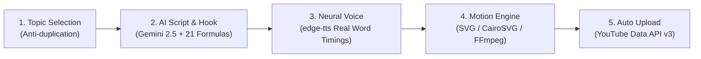

# 🚀 YouTube Runner — 100% Automated YouTube Shorts Pipeline

> **Zero-cost, fully autonomous YouTube Shorts generation pipeline powered by Python, Google Gemini, Microsoft Neural Voice, and a high-performance Python-native Motion Graphics Engine (SVG + CairoSVG + FFmpeg).**

---

## 📌 Architecture Overview



YouTube Runner is built from the ground up for developer and tech channels targeting international English audiences with maximum retention, senior-engineer tone, and zero recurring subscription fees.

---

## 🎨 Visual Identity & Motion Graphics Engine

Rather than relying on generic stock footage or linear slide animations, YouTube Runner features a custom **Python-native Motion Graphics Engine**:

- **Dark Minimalist Aesthetic:** Slate Black (`#0f172a`), Surface (`#111827`), Neon Emerald Green (`#22c55e`), and Sky Blue (`#38bdf8`).
- **macOS Terminal Window Card:** Titlebar with traffic light controls, monospace code lines (`$`, `[OK]`, `[!]`), and live execution status bar.
- **Architecture Flow Diagrams:** High-tech node blocks with accent indicator bars, SVG connector arrows, and spec badges.
- **Kinetic Subtitles:** Spoken word highlight in bold neon green with millisecond-accurate sync powered directly by Microsoft Azure Neural Speech word boundaries.
- **Deterministic Easing:** Mathematical curves including clamped exponential, piecewise cubic S-curve, and harmonic spring with Hermite smoothstep tail stabilization ($t \ge 1.0, v = 0$).

---

## ⚡ Technical Benchmark (Phase 4 Verified)

Tested on 120 frames @ 1080×1920 (30fps vertical Shorts):

| Metric | Option A: FFmpeg Memory Pipe | Option B: Disk-Cached PNGs (Active) |
|---|---|---|
| **Render Speed** | 5.33 FPS | **6.07 FPS (12.3% Faster)** |
| **Peak Python RAM** | 47.43 MB | **29.46 MB (37.9% Less RAM)** |
| **Residual Disk Usage** | 0 MB | **0 MB (Automated Purge)** |
| **Production Stability** | High GC churn | **Optimal for low-cost VPS** |

---

## 🛠️ Prerequisites & Installation

### 1. System Dependencies

#### macOS (via Homebrew):
```bash
brew install cairo ffmpeg
```

#### Ubuntu / Debian VPS:
```bash
sudo apt update
sudo apt install -y libcairo2-dev ffmpeg fonts-dejavu-core
```

### 2. Python Virtual Environment

```bash
git clone https://github.com/YayBwal2/Youtuberunner.git
cd Youtuberunner

python3 -m venv .venv
source .venv/bin/activate
pip install -r requirements.txt
```

### 3. Environment Configuration

Copy `.env.example` to `.env`:
```bash
cp .env.example .env
```

Edit `.env` with your free Google Gemini API key:
```env
# 100% Free from https://aistudio.google.com/
GEMINI_API_KEY=your_gemini_api_key_here

# Neural Voice Selection
VOICE_NAME=en-US-ChristopherNeural
VOICE_RATE=+10%
VOICE_PITCH=+0Hz

# YouTube Upload Settings
YOUTUBE_PRIVACY_STATUS=private
```

---

## 🚀 Usage

### 1. Run Complete Pipeline (Next Trending Topic)
```bash
.venv/bin/python run.py
```

### 2. Run for a Specific Custom Topic
```bash
.venv/bin/python run.py --topic "Why Nvidia Blackwell Draws 1200W"
```

### 3. Dry Run (Generate Script & Audio only, skip render)
```bash
.venv/bin/python run.py --dry-run
```

### 4. Local Render (Skip YouTube Upload)
```bash
.venv/bin/python run.py --no-upload
```

### 5. Automated Daily Scheduler (VPS Cron Mode)
```bash
# Run daily at 18:00 UTC
.venv/bin/python scheduler.py --time "18:00"

# Show crontab instructions for zero-RAM idle scheduling
.venv/bin/python scheduler.py --cron-help
```

---

## 🧪 Testing & Verification

Run the complete unit test suite verifying easing curves, safe area layout boxes, schema validation, and timeline synchronization:

```bash
.venv/bin/python -m unittest discover -s tests -p "test_*.py"
```

### Run Motion Prototype (6–8s Scene)
```bash
.venv/bin/python scripts/run_prototype.py
```

### Run Renderer Architecture Benchmark
```bash
.venv/bin/python scripts/benchmark_render.py
```

---

## 📁 Repository Structure

```
.
├── config.py                 # Central configurations & topic pools
├── run.py                    # Pipeline orchestrator
├── scheduler.py              # Automated daily scheduler
├── core/
│   ├── script_generator.py   # Gemini AI script & hook linter
│   ├── voice_synthesizer.py  # edge-tts neural audio & word timestamps
│   ├── video_engine.py       # Motion Graphics Engine integration
│   ├── video_engine_legacy.py# Fallback rendering engine
│   ├── trends_fetcher.py     # Topic selector with anti-duplication
│   └── youtube_uploader.py   # YouTube Data API v3 OAuth uploader
├── motion/
│   ├── tokens.py             # Colors, typography scale, safe area ratios
│   ├── easing.py             # Exponential, cubic, and spring easing
│   ├── schema.py             # Pydantic v2 Storyboard validation
│   ├── layout.py             # Safe area layout boxes & text fitting
│   ├── timeline.py           # Pause-snapping voice-to-scene mapper
│   ├── svg_builder.py        # Frame SVG composer
│   ├── rasterizer.py         # CairoSVG to FFmpeg rasterizer
│   └── components/
│       ├── cards.py          # macOS Terminal card component
│       ├── typography.py     # Kinetic headlines & active word subtitles
│       └── diagrams.py       # Architecture diagram nodes & connectors
├── skills/                   # Integrated YouTube creator skills
├── templates/
│   └── voice.md              # Channel voice, tone, and forbidden words
├── tests/                    # Unit test suites (13/13 passing)
└── scripts/                  # Prototype and benchmark runners
```

---

## 📜 License

MIT License. Free to use, modify, and deploy.
