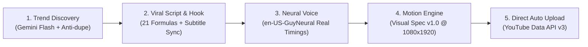

# 🚀 YouTube Runner — 100% Automated YouTube Shorts Pipeline

> **Autonomous, zero-cost YouTube Shorts generation pipeline powered by Python, Google Gemini, Microsoft Neural Voice, and a high-performance Python-native Motion Graphics Engine (SVG + CairoSVG + FFmpeg).**

---

## 📌 Features & Architecture



- 🤖 **Automated Trend Discovery:** Uses Google Gemini to brainstorm high-retention tech and AI topics with automatic duplicate prevention (`outputs/used_topics.json`).
- 📝 **Fireship-Style Kinetic Scripting:** 21 proven viral hook formulas, scored retention linting, and millisecond-accurate word timestamps.
- 🎙️ **Studio-Grade Neural TTS:** 100% free synthesis via Microsoft Edge Neural Speech (`en-US-GuyNeural`).
- 🎬 **Visual Spec v1.0 Motion Graphics Engine:**
  - **Hook Typo Hero:** Kinetic display typography with mathematical auto-scaling (zero text clipping) and neon pill badge.
  - **Single Focused Stage:** 800×820px macOS dark terminal window with glowing green nodes and animated connectors.
  - **Payoff Verdict Card:** High-contrast verdict card (`$0 / MO`, `RUNS FOREVER`) with loop anchor call-to-actions.
- ⏰ **Automated Daily Scheduling:** Pre-configured for **3 videos per day** (06:00, 12:00, 18:00) with local macOS background mode or zero-RAM Linux VPS Crontab.
- 🚀 **YouTube Data API v3 Direct Upload:** Seamlessly uploads vertical Shorts with dynamic titles, descriptions, hashtags, and custom thumbnails.

---

## 🛠️ Prerequisites & Installation

### 1. System Dependencies

#### macOS (via Homebrew):
```bash
brew install cairo ffmpeg
```

#### Ubuntu / Debian VPS:
```bash
sudo apt update
sudo apt install -y libcairo2-dev ffmpeg fonts-dejavu-core
```

---

### 2. Python Virtual Environment

```bash
git clone https://github.com/YayBwal2/Youtuberunner.git
cd Youtuberunner

python3 -m venv .venv
source .venv/bin/activate
pip install -r requirements.txt
```

---

## 🔑 API & Authentication Setup

### Step 1: Google Gemini API Key (Script & Topic Discovery)
1. Get a **100% Free** API key from [Google AI Studio](https://aistudio.google.com/).
2. Copy `.env.example` to `.env`:
   ```bash
   cp .env.example .env
   ```
3. Open `.env` and paste your key:
   ```env
   GEMINI_API_KEY=your_gemini_api_key_here
   GEMINI_MODEL=gemini-3.8-flash
   VOICE_NAME=en-US-GuyNeural
   YOUTUBE_PRIVACY_STATUS=private
   ```

*(Note: `.env` is listed in `.gitignore` and will never be pushed to Git).*

---

### Step 2: YouTube Data API v3 Credentials (Auto-Upload)
To enable automated YouTube uploads, configure a free desktop client ID in Google Cloud Console:

1. Open [Google Cloud Console](https://console.cloud.google.com/) and create a project (e.g. `YouTube Runner`).
2. Go to **APIs & Services > Library**, search for **YouTube Data API v3**, and click **Enable**.
3. Go to **APIs & Services > OAuth consent screen** (or Google Auth Platform):
   - Choose User Type: **External**
   - Fill in App Name (e.g. `YouTube Runner`) and your email address.
   - Under **Test Users**, click **+ ADD USERS** and add the Gmail address associated with your YouTube Channel. Click Save.
4. Go to **APIs & Services > Credentials**:
   - Click **+ Create Credentials > OAuth client ID**.
   - Select **Application type:** `Desktop app`.
   - Name it `YouTube Runner Desktop` and click **Create**.
5. Click **Download JSON** on the created client ID.
6. Rename the downloaded file to **`client_secret.json`** and place it in the project root directory:
   ```
   Youtuberunner/client_secret.json
   ```
7. Run the one-time authentication flow:
   ```bash
   .venv/bin/python run.py --no-upload
   ```
   Or run the quick auth script:
   ```bash
   .venv/bin/python -c "from core.youtube_uploader import get_authenticated_service; get_authenticated_service()"
   ```
   A browser window will open. Sign in with your YouTube account and click **Allow**. This automatically generates **`token.json`** with a refresh token that never expires. All future uploads will be 100% headless and automatic!

---

## 🚀 Running the Pipeline

### 1. Fully Automated Run (Auto-Discovers Trending Topic + Render + Upload)
```bash
.venv/bin/python run.py
```

### 2. Run for a Specific Custom Topic
```bash
.venv/bin/python run.py --topic "Zero-Cost AI: Self-Hosting Open-Source LLMs on a VPS using Docker"
```

### 3. Local Render Only (Skip YouTube Upload)
```bash
.venv/bin/python run.py --no-upload
```

### 4. Custom Privacy Mode (`private`, `unlisted`, `public`)
```bash
.venv/bin/python run.py --privacy public
```

### 5. Dry Run (Script and Audio only, skips video render)
```bash
.venv/bin/python run.py --dry-run
```

---

## ⏰ Automated Daily Scheduling (3 Videos / Day)

By default, the scheduler is set to run at **06:00, 12:00, and 18:00**:

### Option A: Local Mac / Desktop Background Process
Keep your Mac from sleeping while running the scheduler 24/7:
```bash
caffeinate -i .venv/bin/python scheduler.py
```

### Option B: Linux VPS Crontab (Zero RAM Idle - Recommended)
Run `crontab -e` on your server and paste:
```cron
0 6 * * * cd '/path/to/Youtuberunner' && .venv/bin/python run.py >> outputs/cron.log 2>&1
0 12 * * * cd '/path/to/Youtuberunner' && .venv/bin/python run.py >> outputs/cron.log 2>&1
0 18 * * * cd '/path/to/Youtuberunner' && .venv/bin/python run.py >> outputs/cron.log 2>&1
```

*(YouTube Data API v3 daily free quota is 10,000 units. 3 uploads/day consume 4,800 units, well within the free tier).*

---

## 📁 Output Organization

Every video run is saved in its own self-contained folder under `outputs/videos/<timestamp_slug>/`:
```
outputs/videos/20261027_002703_zero_cost_ai_self_hosting/
├── 20261027_002703_zero_cost_ai_self_hosting.mp4    # 1080x1920 60fps vertical video
├── thumbnail.png                                     # 1080x1920 high-contrast thumbnail
├── audio.mp3                                         # Studio-grade synthesized audio
└── script.json                                       # Complete metadata, hooks, and YouTube video ID
```

---

## 🧹 Automated VPS Storage Lifecycle Management

To prevent low-cost VPS disks (e.g. 10GB/20GB SSDs) from filling up when producing 3 videos daily (~90 videos/month), YouTube Runner features an **automated storage lifecycle manager**:

- **Auto-Purge Post Upload:** Once a video is successfully uploaded to YouTube and exceeds the retention threshold (default: 3 days), heavy media files (`.mp4`, `.mp3`, `.png`) are automatically deleted.
- **Metadata Preserved Forever:** Lightweight `script.json` (~2KB) is preserved permanently with the YouTube video ID, URL, topic, timestamps, and upload status.
- **Configurable Retention:**
  ```env
  STORAGE_RETENTION_DAYS=3     # Keep media for 3 days before auto-purge
  AUTO_CLEANUP_AFTER_UPLOAD=true # Run cleanup automatically after each upload
  ```
- **Manual Cleanup Command:**
  ```bash
  .venv/bin/python run.py --cleanup --retention-days 3
  ```

## 🧪 Testing

Run the full unit test suite (13 passing tests verifying layout, schemas, font scaling, and timeline sync):
```bash
.venv/bin/python -m unittest discover tests/
```

---

## 🔒 Security & Privacy

The following sensitive files are explicitly ignored in `.gitignore`:
- `.env` (contains your personal Gemini API key)
- `client_secret*.json` (OAuth client credentials)
- `token.json` (Google OAuth user tokens)
- `outputs/` and `temp/` (generated videos, thumbnails, and cache)

**Never commit or share your `.env`, `client_secret.json`, or `token.json` files publicly.**

---

## 📜 License

MIT License. Free to use, fork, and deploy for personal or commercial YouTube automation.
